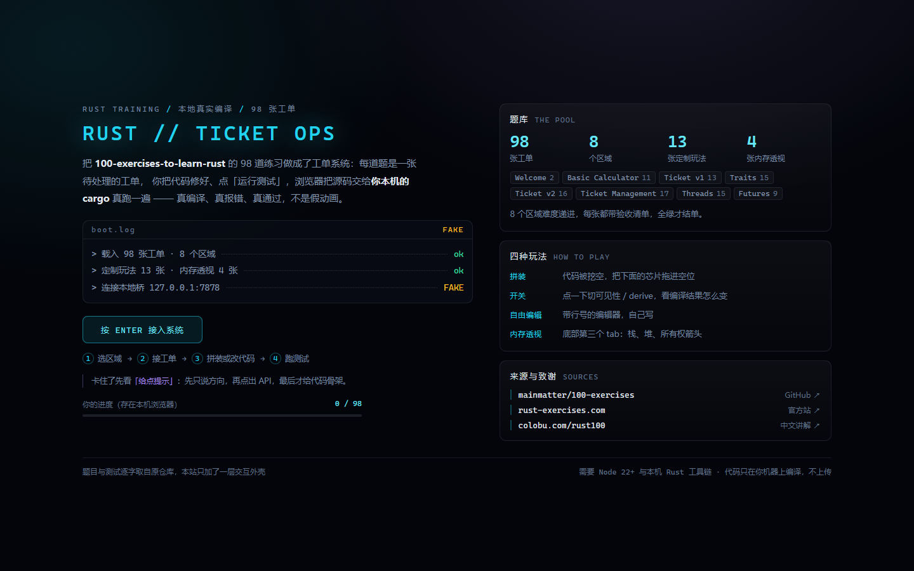
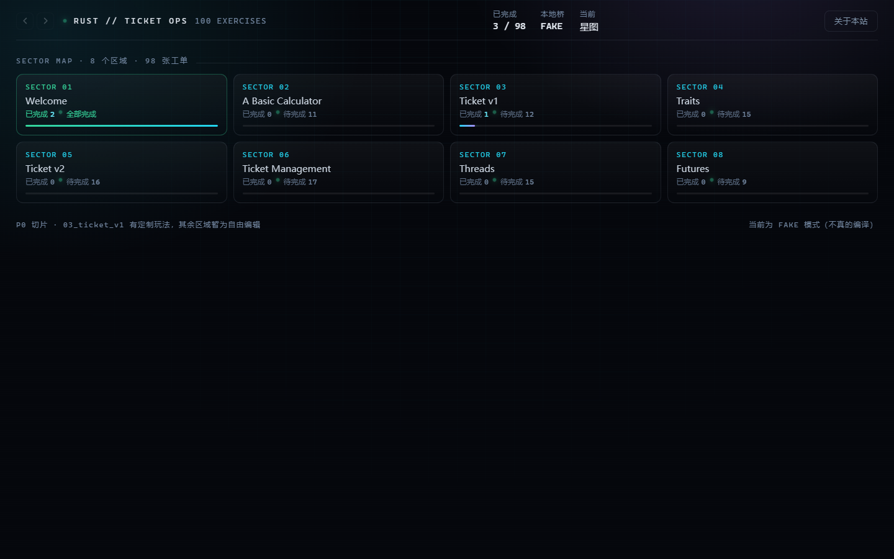
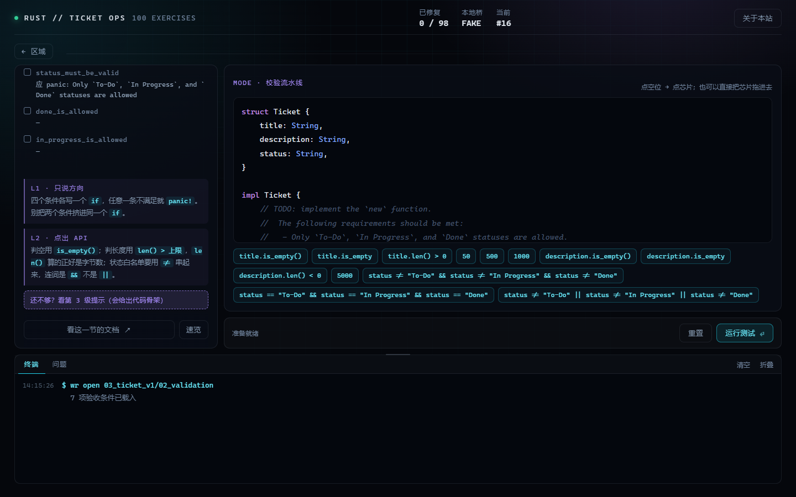
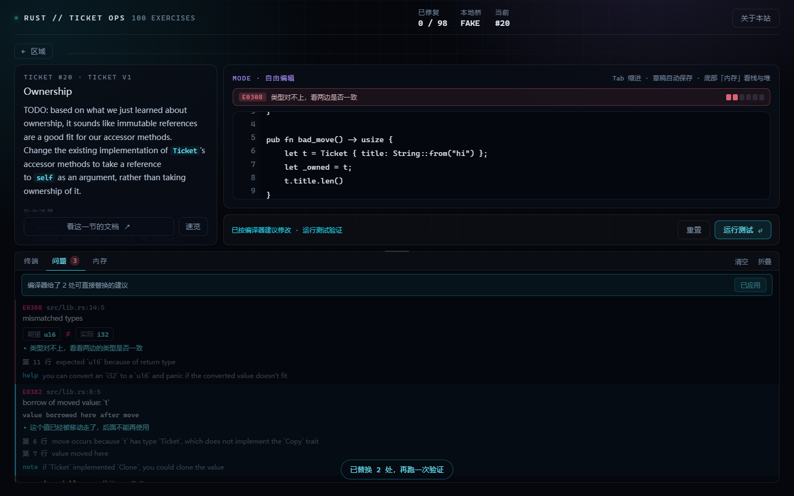
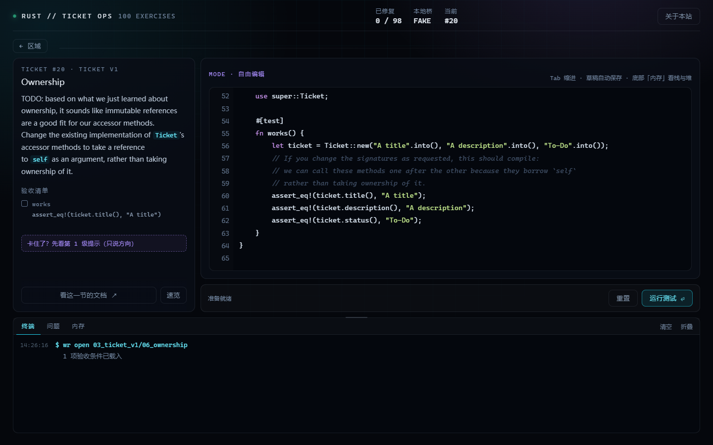
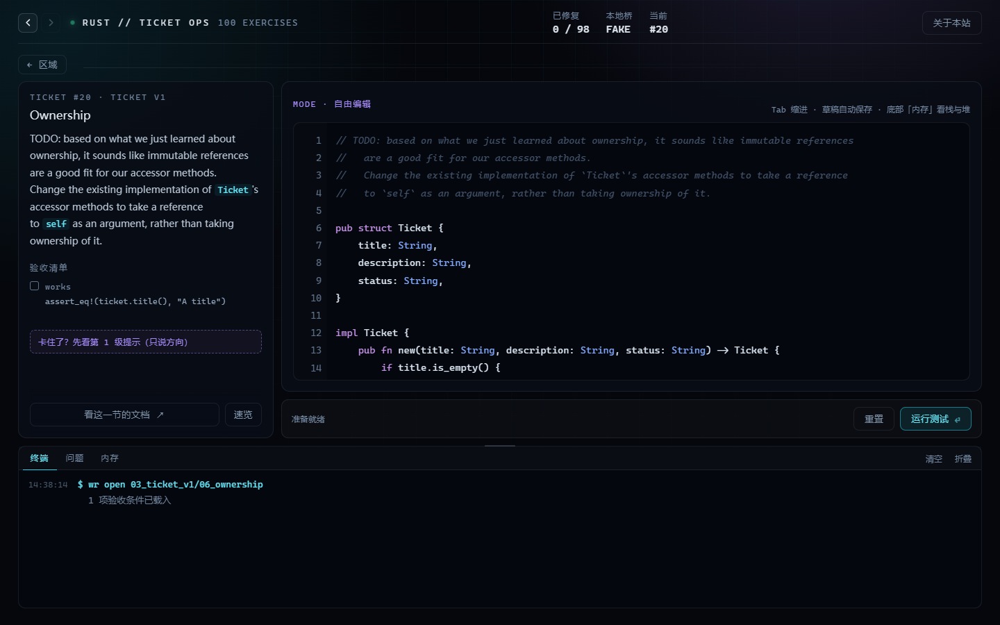
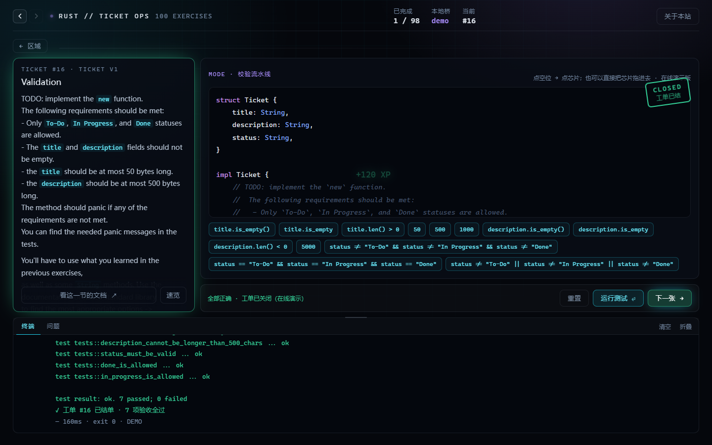

# Rust // Ticket Ops

> 把 [`mainmatter/100-exercises-to-learn-rust`](https://github.com/mainmatter/100-exercises-to-learn-rust) 的 98 道题，
> 做成一个**工单系统**主题的交互式学习站：每一道题是一张待处理的工单，你把代码改好、点「运行测试」，
> 浏览器把源码交给**你本机的 cargo** 真跑一遍——真编译、真报错、真通过。

原课程是用 mdBook + 命令行 `wr` 工具链的纯练习仓库，本仓库在**完全保留上游题面与测试**的前提下，
外挂了一层 Web 交互壳。题面文字、测试代码、验收条件全部逐字来自上游，没有改一个字。

- 在线演示（无需安装，判定降级为前端模拟）：<https://rust-ticket-ops.app.workbuddy.host/?sharecode=GH2UA2XF6I>
- 本地完整体验（真 cargo）：见下方 [快速开始](#快速开始)



---

## 目录

- [它长什么样](#它长什么样)
- [做了什么改造](#做了什么改造)
- [快速开始](#快速开始)
- [目录结构](#目录结构)
- [几条设计约束](#几条设计约束)
- [上游课程说明（原文保留）](#上游课程说明原文保留)
- [License](#license)

---

## 它长什么样

| 区域星图 | 工单 + 三级提示 |
|---|---|
|  |  |
| 8 个区域、98 张工单，每张卡片直接显示**已完成 / 待完成**，全绿才结单 | 卡住了按级解锁提示：只说方向 → 点出 API → 给骨架，不直接给答案 |

| 编译器说全 | 编辑器语法高亮 |
|---|---|
|  |  |
| rustc 的 `E0308` 变成「期望 u16 / 实际 i32」对照卡，两处可机器修复的错误一键「全部替换」 | 自由编辑模式的 textarea 也带行号、关键字/字符串/数字着色与当前行底纹 |

| 前进 / 后退 | 在线演示模式 |
|---|---|
|  |  |
| HUD 左上角 ← →，真实浏览器历史，刷新、深链、后退都不会丢位置 | 没有本地桥时诚实降级：拼装题前端判定，自由编辑题明确拒绝，绝不伪造 rustc 输出 |

<sub>截图取自本地 `--fake` 模式，所以 HUD 上显示 FAKE；右上角那枚计数是「已完成 / 总题数」。</sub>

---

## 做了什么改造

上游是一个「clone 下来、在编辑器里做题、命令行跑 `wr`」的练习仓库。对新手来说有三处摩擦：
**要会命令行**、**报错看不懂**、**卡住没人管**。改造就围绕这三点。

### 1. 首页：先说清这是什么

原来的落地页只有一句「按 ENTER 进入」。现在是一屏能读完的说明页：本站定位、启动日志、四步走法、
提示入口、你的进度，右侧三张卡分别交代**题库规模**（98 张工单 / 8 个区域 / 13 张定制玩法 / 4 张内存透视，
外加每个区域的题数）、**四种玩法**、**来源与致谢**（GitHub 仓库 / 官网 / 中文讲解）。

- 数字不写死，全部由 `web/data/exercises.json` 现算，题目变了首页跟着变。
- 1440×900 与 1080×580 两档都做过一屏验证（矮屏走 `@media (max-height:720px)` 收紧）。
- HUD 右上角「关于本站」随时回看这一页。

### 2. 题库：98 道题变成 8 个区域、98 张工单

| 项 | 数量 | 说明 |
|---|---|---|
| 区域（Sector） | 8 | 对应上游 8 个章节，`01_intro` → `08_futures` |
| 工单 | 98 | 上游全部练习题，题号与章节一一对应 |
| 定制玩法 | 13 | `03_ticket_v1` 全区做了拼装 / 开关 / 编辑器三种交互 |
| 内存透视 | 4 | 全在 `03_ticket_v1`：整数在栈、`String` 在堆、引用只是地址、所有权转移，底部第三个 tab 按步骤画指针 |

其余区域统一走**自由编辑**模式：左边题面 + 验收清单，右边带行号的代码编辑器，跑完给逐条测试结果。

四种玩法（前三张卡就是它们）：

- **拼装** —— 代码被挖空，把下面的「芯片」拖进空位。适合记不住 API 名字的题。
- **开关** —— 点一下切可见性 / `derive`，看编译结果怎么变。适合理解 trait 与模块边界。
- **自由编辑** —— 行号编辑器，自己写。适合真正动手。
- **内存透视** —— 底部第三个 tab，箭头由 DOM 坐标实时绘制，窗口 resize 会重画。

### 3. 真实编译：浏览器不跑 Rust，本机 cargo 跑

`bridge/server.mjs` 是一个 Node 22 小服务：托管静态文件 + 提供 `POST /api/run`。
点「运行测试」时，它把当前源码写进 `.workbuddy/runs/<章节>_<题号>/` 的临时 crate，
复制该题的 `tests/`，然后真的执行 `cargo test`，把结果结构化后回传。

带来的好处是**没有模拟器**：报错文本、测试名、`panicked at` 的位置，全部是你本机 rustc 说的原话。
代价是需要本机装 Rust，所以另外做了在线演示模式（见第 8 条）。

### 4. 编译器说全：把 rustc 输出变成能读的东西

这是改动最大的一块。原来只把 cargo 的 stderr 原样贴进终端，现在走 `--message-format=json` 拿结构化诊断，
再做四层加工：

1. **人话翻译** —— `E0308` 显示成「类型对不上，看看两边是否一致」，`E0382` 显示「这个值已经被移动走了」。
   上方「问题」tab 计数，逐条列出错误码、位置、类型对照。
2. **类型对照卡** —— `E0308` 单独渲染成「期望 `u16` / 实际 `i32`」两枚芯片 + 一行「第 11 行 `expected u16 because of return type`」，
   比读一整段 `expected ..., found ...` 快得多。
3. **一键修复** —— 只收集 `suggestion_applicability == "MachineApplicable"` 的建议（rustc 自己认为可以无脑套用的那种），
   点「全部替换」一次性改掉，然后提示「已替换 2 处，再跑一次验证」。
4. **去重** —— 同一份源码会被 lib 与 lib-test 两个 target 各编译一次，同一条诊断会报两遍，按 `level + code + message + 位置` 去重。

两个实现坑记在这里，省得以后踩：

- 诊断里的 `span` 用的是 **UTF-8 字节偏移**，不是 JS 字符串下标。改源码必须走 `TextEncoder` / `TextDecoder` 按字节切，否则中文注释一出现替换位置就歪。
- 切到 JSON 之后，**libtest 的输出仍然是纯文本**，所以测试结果的解析逻辑不用动；但 `error[E0308]:` 这行不再出现在文本流里，
  错误码、终端渲染都得从诊断里补回来。

### 5. 三级提示 + 失败解释：卡住时有台阶

每张定制工单左下角有「卡住了？先看第 1 级提示」：

| 级别 | 给什么 | 例子（`status` 校验那题） |
|---|---|---|
| L1 · 只说方向 | 讲思路，不给代码 | 「四个条件各写一个 `if`，任意一条不满足就 `panic!`。别把两个条件挤进同一个 `if`」 |
| L2 · 点出 API | 点出可用方法 | 「判空用 `is_empty()`；判长度用 `len() > 上限`，`len()` 算的正好是字节数；状态白名单要用 `!=` 串起来，连词是 `&&` 不是 `\|\|`」 |
| L3 · 给个骨架 | 结构给了，逻辑自己填 | `if status != "To-Do" && status != "In Progress" && status != "Done" { panic!("…") }` |

解锁级别存本地（`ticketops.hint.v1.<题号>`），不会因为刷新被重置。
跑挂的时候，除了逐条列 `✗ test_x 没过 · <原因>`，还会：
**点名失败的测试** → **滚到提示区** → 加一行「▸ 这题在考：<L1 方向>」。
提示内容维护在 `scripts/hints.src.mjs`，构建时生成 `web/data/hints.json`。

### 6. 编辑器：textarea 也能有语法高亮

上游 85 道题走自由编辑，编辑器是原生的 `<textarea>`——它没法着色，所以这些题看起来是「一片灰」，
而拼装/开关题是 HTML 渲染的，有高亮。两种模式观感割裂。

解法是经典的**叠层**：textarea 文字全透明（只留光标），底下垫一层 `<pre>` 渲染着色后的同一段文本，
两层共用 `--code-fs` / `--code-lh` / `--gutter-w` 三个变量保证逐字符对齐，滚动同步。

顺带修掉一个老 bug：行号栏用固定 `line-height`，编辑器用另一套，第 65 行时会累积到 58px 的错位。
现在两者都走 `calc(var(--code-fs) * var(--code-lh))`。

### 7. 导航：URL 是唯一状态源

HUD 左上角加了 ← → 两个箭头，但不只是「上一题下一题」：

- 路由三档：`#/`（首页）、`#/chapter/<区域>`（星图）、`#/ex/<区域>/<题号>`（工单）。
- 每次跳转 `history.pushState({ i })` 记一个自增序号，`popstate` 时按序号还原，箭头按 `i` 与 `max` 决定禁用态。
- 因此**刷新、从微信里点开深链、浏览器后退**都能落回同一张工单，不会跳回首页。

### 8. 在线演示：没有桥也要能看

比赛投稿需要「点开链接就能玩」，而本地桥要求装 Rust。做法是加一个静态 `web/api/health`：

```json
{ "ok": false, "demo": true, "note": "在线演示版：没有本地桥……" }
```

前端探测到 `ok !== true` 就进入演示模式：

- **拼装题**——前端按空位内容比对答案，能真判定，通过时照常放结单动画（扫描线 + 印章 + 星图脉冲）。
- **自由编辑题**——明确拒绝，提示「自由编辑需要本地编译，请运行 `node bridge/server.mjs`」。
  宁可少给一个绿灯，也不编造一行 rustc 输出。

### 9. 一些手感上的东西

- **报错战斗条**：编译失败时终端上方出一条红色进度条，按错误数拉长，改对了才消失。
- **结单动画**：全部测试通过后，编辑器上盖一枚 `CLOSED / 工单已结` 印章，星图对应区域脉冲一次。
- **进度可回退**：切题会重置所有特效状态，不会带着上一题的印章进来。
- **文档直达**：每张工单有「看这一节的文档 ↗」跳到中文讲解对应页，旁边「速览」开站内抽屉。
  注意线上题号与本地不完全一致（缺的题会前移），所以跳转是按**题目名字**匹配的，映射表由 `npm run map` 生成。

---

## 快速开始

需要 **Node.js 22+** 与本机 **Rust 工具链**（`cargo` 在 PATH 里）。

```bash
# 完整体验：真编译
npm run dev            # node bridge/server.mjs → http://127.0.0.1:7878
                       # 端口被占会自动往后找 7879…7888

# 只调交互、不想每次等编译
npm run dev:fake       # 加 --fake，不真的调 cargo

# 题目 / 剧本 / 提示有变动时重新生成数据
npm run build          # web/data/exercises.json + scenarios.json + hints.json

# 重抓中文讲解的目录映射
npm run map            # → scripts/colobu-map.json
```

`web/data/*.json` 是**生成产物**，不要手改，下次 `npm run build` 会覆盖。

---

## 目录结构

```
web/                     纯静态前端（无框架、无构建）
  index.html             落地页 + 星图 + 工单台 + 底部终端/问题/内存三 tab
  app.js                 全部逻辑：渲染、路由、判定、提示、诊断渲染
  app.css                视觉令牌已语义化（--fg-1..4 / --accent / --dur-*）
  api/health             在线演示的降级探测文件
  data/*.json            构建产物，禁止手改

bridge/server.mjs        静态托管 + /api/run 真跑 cargo + 诊断加工

scripts/
  build-content.mjs      扫 exercises/ 与 book/ → exercises.json
  build-scenarios.mjs    把锚点替换脚本套到题上 → scenarios.json
  scenarios.src.mjs      13 张定制工单的 [find, replace] 锚点
  hints.src.mjs          13 张工单的三级提示
  memory.src.mjs         4 张内存透视题的栈/堆数据
  fetch-doc-map.mjs      抓中文讲解目录 → colobu-map.json

exercises/               上游原题（本仓库只读，绝不写回）
helpers/                 上游公共依赖库
book/                    上游 mdBook 教材
docs/images/             本 README 的配图
```

---

## 几条设计约束

改这个项目时，下面几条是硬约束，破坏任何一条都会出问题：

1. **本地桥永不写回 `exercises/`**
   所有源码写入只落 `.workbuddy/runs/<章节>_<题号>/`。`CARGO_TARGET_DIR` 指到 `runs/.target`，
   `tests/` 是复制而不是软链，`Cargo.toml` 里的 `path` 依赖改成绝对路径**只读**引用 `helpers/`。
   原因很简单：你的答案不该污染原仓库。

2. **内容管线读 `git show HEAD:<path>`，不读工作区**
   因为你会在本地自己解题，读工作区就会把**你的答案当成题面**发到网站上。要让改动生效，先 commit。

3. **剧本是锚点替换，不是重写**
   `scenarios.src.mjs` 里每条是 `[find, replace]`，要求锚点命中且**只命一次**，否则构建直接失败。
   这样能保证生成的测试代码与仓库里的逐字一致。

4. **演示模式不许编造 rustc 输出**
   没有本地桥时只能做前端能判的事，判断不了的题必须明说不行。

---

## 上游课程说明（原文保留）

以下为上游 `README.md` 原文，未做改动：

> # Learn Rust, one exercise at a time
>
> You've heard about Rust, but you never had the chance to try it out?\
> This course is for you!
>
> You'll learn Rust by solving 100 exercises.\
> You'll go from knowing nothing about Rust to being able to start
> writing your own programs, one exercise at a time.
>
> > [!NOTE]
> > This course has been written by [Mainmatter](https://mainmatter.com/rust-consulting/).\
> > It's one of the trainings in [our portfolio of Rust workshops](https://mainmatter.com/services/workshops/rust/).\
> > Check out our [landing page](https://mainmatter.com/rust-consulting/) if you're looking for Rust consulting or
> > training!
>
> ## Getting started
>
> Go to [rust-exercises.com](https://rust-exercises.com) and follow the instructions there
> to get started with the course.
>
> ## Requirements
>
> - **Rust** (follow instructions [here](https://www.rust-lang.org/tools/install)).\
>   If `rustup` is already installed on your system, run `rustup update` (or another appropriate command depending on how
>   you installed Rust on your system)
>   to make sure you're running on the latest stable version.
> - _(Optional but recommended)_ An IDE with Rust autocompletion support.
>   We recommend one of the following:
>   - [RustRover](https://www.jetbrains.com/rust/);
>   - [Visual Studio Code](https://code.visualstudio.com) with
>     the [`rust-analyzer`](https://marketplace.visualstudio.com/items?itemName=matklad.rust-analyzer) extension.
>
> ## Solutions
>
> You can find the solutions to the exercises in
> the [`solutions` branch](https://github.com/mainmatter/100-exercises-to-learn-rust/tree/solutions) of this repository.

如果你想完全按上游方式学（命令行 `wr`、mdBook 教材），直接看
[rust-exercises.com](https://rust-exercises.com)；本仓库的 `book/`、`exercises/`、`helpers/` 与上游保持一致，
只是多了一层 Web 外壳。

中文讲解参照 [colobu.com/rust100](https://colobu.com/rust100/)。

---

## License

Copyright © 2024- Mainmatter GmbH (https://mainmatter.com), released under the
[Creative Commons Attribution-NonCommercial 4.0 International license](https://creativecommons.org/licenses/by-nc/4.0/).

本仓库的 Web 外壳（`web/`、`bridge/`、`scripts/`、`docs/`）同样遵循上述许可，
上游题面与测试代码版权归 Mainmatter GmbH 所有。
